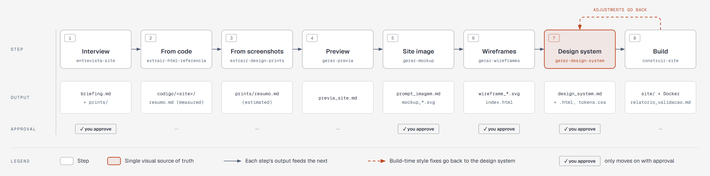

# Template: AI-generated websites + Skills

A template for building **websites, company sites and landing pages** with Claude Code in
**8 steps**, from understanding the business to a validated site ready to deploy. Each step
produces a structured text file the next one reads (briefing, design extracted from references,
preview, SVG wireframes, design system) — and four of them only move on with your approval.

Full plan: [`docs/plano.md`](docs/plano.md) · Process diagram: [`docs/diagrama-processo.html`](docs/diagrama-processo.html)

## The 8 steps



| # | Step | Approval |
|---|------|----------|
| 1 | **Interview & briefing** — business, goal, audience, architecture, hosting, Docker, design, reference sites and screenshots | ✅ |
| 2 | **Design extracted from the references' code** (HTML, CSS and the result of JavaScript) | |
| 3 | **Design extracted from screenshots** | |
| 4 | **Site preview** in Markdown | |
| 5 | **Site image** — prompt + SVG mockup | ✅ |
| 6 | **SVG wireframes** of every page, desktop and mobile | ✅ |
| 7 | **Design system** in Markdown and HTML, with tokens | ✅ |
| 8 | **Plan, build & validation** — code in `site/`, Docker/deploy and a report | |

## How to use

### 1. Create your project from the template

On GitHub, open this repository and click **Use this template → Create a new repository**.
Or from the command line with the [GitHub CLI](https://cli.github.com/):

```bash
gh repo create my-site --template mayconspirlandelli/skills-site-com-ia --private --clone
```

If you created it on the website, clone the new repository:

```bash
git clone https://github.com/<user>/<my-site>.git
```

### 2. Install the third-party skills

From the project folder (on Windows, use Git Bash). The script audits each skill before installing:

```bash
./scripts/setup-skills.sh obrigatorias
```

### 3. Open Claude Code and start

```bash
claude
```

Say something like: *"I want to build a landing page for [your business]."* The
`site-com-referencias` skill drives the 8 steps, starting with the interview. Progress lives in
the `etapas/` folders and in `etapas/aprovacoes.md` — you can stop and resume in another session.

### Requirements

- [Claude Code](https://claude.com/claude-code)
- Git and Bash (Git Bash on Windows)
- Python 3 and `pip install beautifulsoup4 pillow`
- Node.js (for the site and for `playwright-cli`)

## What's in the template

```
├── CLAUDE.md              permanent instructions read in every session
├── .claude/
│   ├── settings.json      project marketplaces and plugins
│   └── skills/            workflow skills (versioned with the project)
├── docs/
│   ├── plano.md           the 8-step plan
│   ├── diagrama-processo.html  8-step diagram (+ .png)
│   ├── skills-obrigatorias.md  third-party skills and how to install them
│   └── recursos.md        useful links (references, animations, skills)
├── scripts/
│   ├── setup-skills.sh    audits and installs the template's third-party skills
│   └── adicionar-skill.sh audits and installs any other skill
├── etapas/                site construction, one folder per step
│   ├── aprovacoes.md      log of your approvals
│   ├── auditorias/        skill audit reports and reviewed exceptions
│   ├── 00_briefing/       briefing.md + uploaded prints/ (screenshots)
│   ├── 01_extracao/       design extracted from code (codigo/) and screenshots (prints/)
│   ├── 02_previa/         site preview
│   ├── 03_mockup/         image prompt and site image
│   ├── 04_wireframes/     SVG wireframes
│   ├── 05_design_system/  design_system.md + design_system.html + tokens.css
│   └── 06_construcao/     build plan and validation report
└── site/                  site code (ready for Docker and deploy)
```

## Included skills

| Skill | Step |
|-------|------|
| `site-com-referencias` | Orchestrates the workflow and approvals, and points to the next step |
| `entrevista-site` | 1 — interview in rounds with recommended answers and briefing.md |
| `extrair-html-referencia` | 2 — measures the references' design in the browser (playwright-cli) and in the code |
| `extrair-design-prints` | 3 — screenshot palette (script) and typography/shape analysis |
| `gerar-previa` | 4 — site preview in Markdown |
| `gerar-mockup` | 5 — prompt and SVG site mockup |
| `gerar-wireframes` | 6 — SVG wireframes of every page + review page |
| `gerar-design-system` | 7 — design_system.md + design_system.html, tokens and contrast |
| `construir-site` | 8 — plan, code in site/, Docker/deploy and validation report |
| `auditar-skill` | Security audit of third-party skills before installing |

## Third-party skills (installed by script)

They are **not bundled** with the template — each one has its own license and author.
`scripts/setup-skills.sh` audits and installs each one in your project. Details and manual
`npx` commands in [`docs/skills-obrigatorias.md`](docs/skills-obrigatorias.md).

| Group | Skills | Command |
|-------|--------|---------|
| Required | `frontend-design`, `web-design-guidelines`, `image-to-code`, `design-taste-frontend`, `playwright-cli`, `diagram-design`, `impeccable` | `./scripts/setup-skills.sh obrigatorias` |
| Animation/video (if the briefing asks) | `remotion-best-practices`, `motion-design` | `./scripts/setup-skills.sh animacao` |
| Extras (optional) | `grill-me`, `grilling` | `./scripts/setup-skills.sh extras` |

## Adding other skills

> 🔒 **Every third-party skill is audited before installation.**
> Skills give instructions to the AI and may ship scripts that run on your machine,
> with access to files, network and credentials. The `auditar-skill` skill checks for prompt
> injection, data exfiltration, credential access, obfuscated code, persistence and
> destructive commands, and gives a verdict: ✅ OK, ⚠️ REVIEW or ⛔ BLOCK.
> Reports are saved in `etapas/auditorias/`.

**Option 1 — Script with automatic audit (recommended).**
```bash
./scripts/adicionar-skill.sh https://github.com/<user>/<repo> <skill-name-or-path>
./scripts/adicionar-skill.sh <url> <skill> --global   # for all projects
```
Downloads to a temp folder, audits, and installs only the audited commit (REVIEW asks for your
confirmation, BLOCK prevents installation).

**Option 2 — Plugin marketplace.**
Before installing a plugin, ask Claude Code: *"audit plugin X from marketplace Y"* —
the `auditar-skill` skill clones the repository and audits each skill, command and hook of the plugin.
Anthropic's official marketplace is already registered in `.claude/settings.json`.
Inside Claude Code:
```
/plugin install example-skills@anthropic-agent-skills --scope project
```
`--scope project` writes the plugin to `.claude/settings.json`, so it goes along with git.
For other marketplaces: `/plugin marketplace add <user>/<repo> --scope project`.

**Option 3 — Create a new skill.**
Ask Claude Code: *"use skill-creator to create a skill that ... and save it in .claude/skills/"*.

After installing: record the skill and the audited commit in the **Additional skills** table
in `CLAUDE.md` and restart Claude Code. Updated the skill? Audit it again.

## Using on Claude.ai (without Claude Code)

- Install the `.skill` files in Settings → Skills.
- Create a Project, paste the contents of `CLAUDE.md` into its instructions, and upload the
  design system and wireframe files as project knowledge as they become ready.

## License

[MIT](LICENSE) — applies to this template's files. Third-party skills installed by
`setup-skills.sh` keep the license of their own source repositories.
