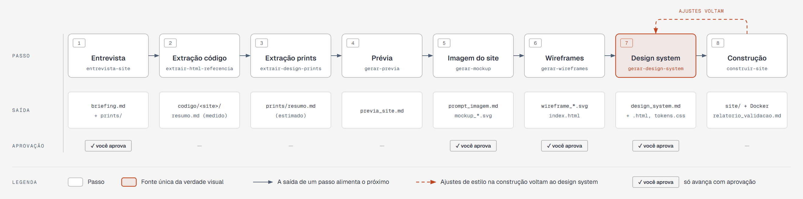

# Plano: criação de sites e landing pages com IA generativa e skills

## Visão geral

O template organiza a criação de um site em **8 passos**, do entendimento do negócio ao site validado. A ideia central: a IA trabalha melhor com **texto estruturado** (briefing, design extraído, wireframes, tokens) do que improvisando a partir de imagens — então cada passo produz um arquivo que o próximo lê. Quatro passos só avançam com a **aprovação do usuário**, porque decisões tomadas cedo contaminam todo o resto.



Versão interativa: [`diagrama-processo.html`](diagrama-processo.html) (abra no navegador).

| # | Passo | Skill | Saída | Aprovação |
|---|-------|-------|-------|-----------|
| 1 | Entrevista e briefing | `entrevista-site` | `etapas/00_briefing/briefing.md` | ✅ |
| 2 | Design extraído do código das referências | `extrair-html-referencia` | `etapas/01_extracao/codigo/<site>/resumo.md` | |
| 3 | Design extraído dos prints | `extrair-design-prints` | `etapas/01_extracao/prints/resumo.md` | |
| 4 | Prévia do site | `gerar-previa` | `etapas/02_previa/previa_site.md` | |
| 5 | Imagem do site | `gerar-mockup` | `etapas/03_mockup/` (prompt + mockup SVG) | ✅ |
| 6 | Wireframes de todas as páginas | `gerar-wireframes` | `etapas/04_wireframes/*.svg` | ✅ |
| 7 | Design system | `gerar-design-system` | `etapas/05_design_system/` (.md + .html + tokens) | ✅ |
| 8 | Plano, construção e validação | `construir-site` | `site/` + `etapas/06_construcao/` | |

A skill `site-com-referencias` conduz tudo: descobre em que passo o projeto está (pelas pastas e por `etapas/aprovacoes.md`) e chama a skill certa.

### Estrutura de pastas

```
projeto-site/
├── etapas/                    construção do site, na ordem do fluxo
│   ├── aprovacoes.md          registro das aprovações do usuário
│   ├── auditorias/            relatórios de auditoria das skills + exceções revisadas
│   ├── 00_briefing/           briefing.md (aprovado) + prints/ enviados pelo usuário
│   ├── 01_extracao/
│   │   ├── codigo/<site>/     design extraído do HTML/CSS/JS das referências
│   │   └── prints/            design extraído dos prints
│   ├── 02_previa/             previa_site.md
│   ├── 03_mockup/             prompt da imagem + imagem do site aprovada
│   ├── 04_wireframes/         wireframes SVG de todas as páginas (aprovados)
│   ├── 05_design_system/      design_system.md + design_system.html + tokens.css
│   └── 06_construcao/         plano_construcao.md + relatorio_validacao.md
└── site/                      só o código do site (pronto para Docker e deploy)
```

---

## Antes de começar — skills de terceiros

```bash
./scripts/setup-skills.sh obrigatorias
```

O script audita cada skill antes de instalar (veja [`skills-obrigatorias.md`](skills-obrigatorias.md)). Reinicie o Claude Code depois.

---

## Passo 1 — Entrevista e briefing ✅

O Claude entrevista o usuário em **rodadas curtas de perguntas, cada uma com uma resposta recomendada** — basta "sim" para aceitar. O roteiro cobre:

- **Negócio:** domínio, o que oferece, tipo de site (landing page, institucional, portfólio...).
- **Objetivo** e **público** (perfil, celular ou computador, idioma, acessibilidade).
- **Páginas, conteúdo e funcionalidades** (formulário, WhatsApp, animações...).
- **Arquitetura:** HTML + CSS, Tailwind, Vite, Astro, Next.js...
- **Hospedagem e Docker:** GitHub Pages, Netlify, Vercel, VPS; container ou não; domínio.
- **Design:** cores de que gosta e que evita, cores da marca, tipografia, tom, modo escuro, responsivo ou PWA.
- **Referências:** 3 a 5 URLs com o que aproveitar e o que evitar de cada uma, e **prints** de telas (salvos em `etapas/00_briefing/prints/`).

**Saída:** `briefing.md`, aprovado pelo usuário. Animações ou vídeos no briefing → `./scripts/setup-skills.sh animacao`.

## Passo 2 — Design extraído do código das referências

Para cada URL, o navegador (`playwright-cli`) abre o site, o JavaScript roda e medimos o que foi **realmente aplicado**: cores de texto e de fundo, fontes, escala de tamanhos (desktop e celular), raios, sombras, containers, breakpoints e variáveis CSS. O HTML renderizado também é limpo e resumido.

**Saída:** um `resumo.md` por site, com a seção "Design system extraído". Sem URLs, o passo não se aplica.

## Passo 3 — Design extraído dos prints

Um script tira a paleta de cada print (com área de cada cor, destaque provável e contraste); o Claude analisa tipografia, espaçamento, formas e componentes. Tudo marcado como **estimado** — imagem não guarda valores exatos.

**Saída:** `etapas/01_extracao/prints/resumo.md`. Sem prints, o passo não se aplica.

## Passo 4 — Prévia do site

Junta briefing e extrações num só documento: páginas e seções em ordem, conteúdo de cada uma, direção visual (paleta e tipografia candidatas, com a origem de cada valor), o que vem de cada referência, conflitos a decidir e decisões técnicas.

**Saída:** `previa_site.md`.

## Passo 5 — Imagem do site ✅

O passo criativo: o Claude escreve um **prompt** a partir da prévia e **desenha o mockup em SVG** (colorido, com tipografia de verdade) — Home no desktop e no celular, no mínimo. O prompt também serve para gerar a imagem em qualquer ferramenta de IA de imagem. Cada ajuste gera uma nova versão.

**Saída:** `prompt_imagem.md` + mockup aprovado pelo usuário.

## Passo 6 — Wireframes de todas as páginas ✅

A estrutura de **cada página e subpágina** em SVG cinza, desktop e celular: seções, layout, quantidades e o que muda no celular, anotados em atributos que a IA lê na construção. Uma página `index.html` mostra todos lado a lado para a revisão. Aprovados, viram a especificação de componentes.

**Saída:** `wireframe_<pagina>-desktop.svg` / `-mobile.svg`, `index.html`, `especificacao_componentes.md`.

## Passo 7 — Design system ✅

A **fonte única da verdade visual**: paleta com papéis, tipografia, espaçamento, layout, bordas, sombras, componentes e regras — decisões próprias, coerentes com a imagem aprovada, com contraste WCAG verificado por script. Gera `tokens.css` (e tokens para Tailwind) e o `design_system.html`, a versão visual para o usuário aprovar.

Ordem de confiança quando as fontes discordam: **decisão do usuário > medido no código > estimado dos prints > lido da imagem**.

**Saída:** `design_system.md`, `design_system.html`, `tokens.css`.

## Passo 8 — Plano, construção e validação

1. **Plano de construção:** stack, pastas, páginas e seções (que viram checklist), componentes, conteúdo e placeholders, funcionalidades, entrega e critérios de aceite. O usuário confirma antes do código.
2. **Construção** em `site/`, seção por seção, só com tokens, conferindo cada seção com o wireframe.
3. **Entrega:** `Dockerfile` + `nginx.conf` se houver Docker; arquivos da hospedagem (GitHub Pages, Netlify, Vercel...).
4. **Validação contra o plano:** cada seção, funcionalidade e arquivo de entrega; responsividade em 375/768/1280px; acessibilidade; build e Docker; Lighthouse.

**Saída:** `site/`, `plano_construcao.md` e `relatorio_validacao.md` (✅ passou · ❌ falhou · ⚠️ não verificado).

---

## Regras que valem em todos os passos

- O `design_system.md` aprovado é a fonte única da verdade visual: mudança de estilo começa nele, e os tokens são regenerados.
- No código, só tokens — nada de cores, tamanhos ou espaçamentos soltos.
- Nunca copiar textos, imagens, logos ou código das referências: conteúdo do briefing ou placeholders `[TEXTO: ...]`.
- Nunca gerar por IA imagens de pessoas reais que o site apresenta como reais.
- Skill ou servidor MCP de terceiros só depois de auditoria (`auditar-skill`).
